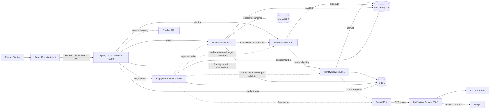

# NovelForge Architecture

Last verified: 2026-11-05. This document describes the checked-in application and deployment configuration. It is not evidence of a live production deployment.

## System context

The gateway is the browser entry point. Downstream application services are intended to remain private to the Compose/Render network. Eureka handles registration/discovery; the default local gateway routes use direct service URLs, while the performance Compose override uses Eureka-backed load balancing.

## Runtime components

| Component | Owns / provides | State and dependencies |
|---|---|---|
| `novelforge-client` | Reader, creator studio, profile, staff UI, invitation Inbox | React JSX, Vite, React Router; served by Nginx in Docker |
| `api-gateway` | Browser routing, path rewriting, OTP rate limits | Spring Cloud Gateway / WebFlux; host port `8080`; Redis for rate limiting |
| `identity-service` | Registration, authentication, user/profile/creator lifecycle, admin and moderation APIs | PostgreSQL `userDB`, Redis, RabbitMQ OTP publishing |
| `novel-service` | Novel metadata, search, chapter lifecycle and ordered content blocks | PostgreSQL `novelDB`, MongoDB chapter documents, Redis cache |
| `studio-service` | Studios, permissions, memberships and invitations | PostgreSQL `studioDB`; calls Identity for creator eligibility |
| `engagement-service` | Likes, comments, posts, follows, feeds and collections | PostgreSQL `engagementDB`, Redis, RabbitMQ feed fanout; calls Identity, Studio and Novel for authorization/validation |
| `notification-service` | Asynchronous OTP email delivery | RabbitMQ consumer; configured SMTP or Brevo adapter; Mailpit is available locally |
| `eureka-server` | Service registry | Eureka on port `8761` |
| `novelforge-common`, `novelforge-security` | Shared Java domain/error/security utilities | Maven modules used by backend services |

Admin and moderation are API areas hosted by `identity-service`; they are not separate deployables. `notification-service` is not a general in-app notification API. Studio invitations are persisted as membership rows and surfaced by the Studio API and client Inbox. AI and analytics services are not part of the current deployment.

## Gateway contracts

| Browser path | Owner | Notes |
|---|---|---|
| `/api/v1/identity/**` | Identity | Registration, login, profile and user directory |
| `/api/v1/admin/**` | Identity | Admin user search, role/status updates and stats |
| `/api/v1/moderation/**` | Identity | Reports and triage |
| `/api/v1/novels/**` | Novel | Public catalog plus authenticated authoring; `/novels/studios/**` is rewritten to the service's `/studios/**` controller paths |
| `/api/v1/studios/**` | Studio | Studio lifecycle, team membership and invitations |
| `/api/v1/engagement/**` | Engagement | Social actions, posts, feed and reading collections |
| No browser route | Notification | Internal RabbitMQ email delivery only |

The profile API supports `PATCH /api/v1/identity/profile/me` for username, display name, bio, ImageKit profile/banner URLs and visibility. Upload bytes go directly from the browser to ImageKit using short-lived authorization from Identity; only the resulting URL is stored by NovelForge.

Studio collaboration uses `GET /api/v1/studios/invitations/me` to list the signed-in user's pending invitations, `PATCH /api/v1/studios/invitations/{membershipId}/read` to mark one read, and `POST /api/v1/studios/invitations/{membershipId}/accept` to accept. Identity/Studio backends enforce user and permission boundaries.

See [API.md](API.md) for request, response and authentication details.

## Data ownership

PostgreSQL runs as one local container, but `docker/postgres/init-dbs.sql` creates a separate database per service: `userDB`, `novelDB`, `studioDB`, and `engagementDB`. This is logical ownership, not separate PostgreSQL infrastructure. MongoDB stores chapter documents and content blocks. Redis holds cache and short-lived/rate-limit state. RabbitMQ carries asynchronous OTP and feed events.

## Local deployment

1. Copy `.env.example` to `.env` and set unique local secrets. Do not commit `.env`.
2. Start the stack with `docker compose up -d --build`.
3. Open the client at `http://localhost:3000`, gateway at `http://localhost:8080`, and Eureka dashboard at `http://localhost:8761`.
4. Stop with `docker compose down`.

The client can also run from `novelforge-client` with `npm install` and `npm run dev`; its default API base is `http://localhost:8080`. See [novelforge-client/README.md](novelforge-client/README.md).

The optional `NOVELFORGE_ADMIN_DEFAULT_PASSWORD` bootstraps the first `admin` account if no admin exists. Identity hashes it with BCrypt. Set it only through the ignored local `.env` or deployment secret store, then remove it after provisioning. Existing installations should use the authorized Admin Console rather than inserting account/role rows by hand.

## Scaling and limits

`docker-compose.yml` runs one instance per application service and configures direct Docker service URLs. It does not configure automatic horizontal scaling. `docker-compose.perf.yml` changes supported gateway destinations to `lb://` Eureka routes, removes fixed container names where replicas are measured, and applies benchmark resource limits. That override is for local experiments, not a production deployment recipe.

The checked-in benchmarks cover selected read, write, auth, mixed, and failover workloads across one to three local instances. For example, the capacity report records a public catalog test increasing from about 222 requests/s at one instance to about 543 requests/s at two at 50 connections, while the three-instance result was lower; selected chapter-read tests exceeded 1,000 requests/s at three instances. These are measurements from a specific Docker Desktop host and workload, not a maximum user count or cloud capacity guarantee. Shared PostgreSQL, Hikari pools, gateway CPU, service resources and workload mix constrain results.

- [Capacity profile and bottlenecks](docs/performance/CAPACITY_PROFILE.md)
- [Benchmark methodology and results](docs/performance/PERFORMANCE_REPORT.md)
- [Detailed discovery and performance topology](docs/performance/ARCHITECTURE.md)
- [Render configuration notes](RENDER_DEPLOYMENT.md)

## Security and operational boundaries

- Browser requests use the API Gateway; service-to-service credentials remain server-side.
- Admin, moderator and Studio permissions are enforced by backend endpoints; UI visibility is not an authorization boundary.
- Never commit JWT, OTP, ImageKit private, database, broker, admin bootstrap, or internal service credentials.
- Moderation resolution records triage but does not itself remove content or suspend an account.
- Local Compose configuration and performance results do not prove production readiness. Cloud operation also needs verified migrations, backups, monitoring/alerts, secret rotation, recovery procedures and deployment-specific load tests.
