# NovelForge OTP email flow

This diagram covers registration and password reset. It distinguishes a request accepted by RabbitMQ from an email later accepted by a provider.

```mermaid
sequenceDiagram
    autonumber
    actor User as Browser / User
    participant GW as API Gateway
    participant ID as Identity Service
    participant R as Redis
    participant MQ as RabbitMQ
    participant W as Notification Worker
    participant IC as Internal challenge check
    participant Mail as Mailpit / Email Provider
    participant DLQ as Dead-letter Queue

    rect rgb(235, 245, 255)
        Note over User,R: 1. Request and create current OTP challenge
        User->>GW: POST send-otp (email)
        GW->>GW: IP token bucket (10 tokens/second; burst 10)
        alt Gateway rate limit exceeded
            GW-->>User: 429 Too Many Requests
        else Gateway allows request
            GW->>ID: Forward with gateway-owned client IP
            Note over GW,ID: Identity enforces the stricter per-email/IP request limits below.
            ID->>R: Atomic Lua send counters
            alt Email/IP send limit exceeded
                R-->>ID: Denied
                ID-->>User: 429 Too Many Requests
            else Send limit allows
                alt Purpose is REGISTRATION
                    ID->>ID: Reject if email already registered
                    ID->>ID: Generate six-digit OTP + challengeId
                    ID->>R: Store email + HMAC(OTP) + challengeId (5m)
                else Purpose is PASSWORD_RESET
                    ID->>ID: Look up email without revealing result
                    ID->>R: Invalidate any prior reset challenge for this flow
                    alt Email does not exist
                        ID-->>User: 202 Accepted; no email queued
                    else Email exists
                        ID->>ID: Generate six-digit OTP + challengeId
                        ID->>R: Store email + HMAC(OTP) + challengeId (5m)
                    end
                end
                ID->>MQ: Persistent JSON event, priority 10
                Note right of MQ: Event carries plaintext OTP for email delivery.
                Note right of MQ: HMAC is one-way; worker cannot recover OTP from Redis.
                alt Queue full, unroutable, NACK, or confirm timeout
                    MQ-->>ID: Reject / return / no confirm
                    ID->>R: Compare-delete this challengeId only
                    ID-->>User: Request failed; no 202
                else Broker confirms publish
                    MQ-->>ID: Publisher confirm ACK
                    ID-->>GW: 202 Accepted + HttpOnly flow cookie
                    GW-->>User: 202 Accepted (queued, not delivered)
                end
            end
        end
    end

    rect rgb(240, 250, 242)
        Note over MQ,Mail: 2. Asynchronous delivery, independent of HTTP request
        MQ->>W: @RabbitListener receives queued event
        W->>R: Check sent marker by notificationId
        alt Already marked sent / obsolete
            R-->>W: Marker exists
            W-->>MQ: Acknowledge duplicate
        else New event
            W->>IC: Validate purpose, email, flowId, challengeId
            IC->>R: Read purpose-specific current challenge
            alt Challenge expired or superseded by resend
                R-->>IC: Not current (410)
                IC-->>W: Stale challenge
                W->>R: Record OBSOLETE marker (7d)
                W-->>MQ: Acknowledge without sending
            else Challenge still current (204)
                R-->>IC: Current
                IC-->>W: Send is allowed
                W->>W: Render registration or reset email template
                W->>Mail: SMTP (Mailpit local) or Brevo API
                alt Provider accepts email
                    Mail-->>W: Accepted
                    W->>R: Record SENT marker (7d)
                    W-->>MQ: Acknowledge message
                else Temporary provider / identity-check failure
                    Mail-->>W: Temporary error
                    W->>W: Retry up to 4 attempts with exponential backoff
                    alt Retry succeeds
                        W->>Mail: Attempt delivery again
                        Mail-->>W: Accepted
                        W->>R: Record SENT marker
                        W-->>MQ: Acknowledge message
                    else Retries exhausted
                        W->>DLQ: Reject without requeue → dead-letter
                        Note over DLQ: DLQ TTL is 10 minutes; message body includes plaintext OTP.
                    end
                else Permanent provider rejection
                    Mail-->>W: Permanent 4xx rejection
                    W->>R: Record PERMANENT_FAILURE marker
                    W->>DLQ: Reject without requeue → dead-letter
                end
            end
        end
    end

    rect rgb(250, 245, 235)
        Note over User,R: 3. User verifies code, then finishes the purpose-specific flow
        User->>GW: POST verify (OTP + same flow cookie)
        GW->>GW: IP token bucket (10 tokens/second; burst 10)
        GW->>ID: Forward request
        ID->>R: Atomic Lua verify counter (5/flow, 100/IP per 5m)
        alt Verification limit exceeded
            ID-->>User: 429 Too Many Requests
        else Within verification limit
            ID->>R: HMAC submitted OTP; atomically compare + consume
            alt Wrong, expired, or superseded OTP
                R-->>ID: Invalid
                ID-->>User: Invalid or expired code
            else Correct current OTP
                R-->>ID: Valid; set purpose-specific verified state (10m)
                ID-->>User: Verification succeeded
                alt Registration purpose
                    User->>GW: POST /register (same flow cookie)
                    GW->>ID: Forward registration details
                    ID->>R: Require verified email; clear verified state
                    ID->>ID: Create account and issue JWTs
                    ID-->>User: Registration complete
                else Password reset purpose
                    User->>GW: POST reset password (same flow cookie)
                    GW->>ID: Forward new password
                    ID->>R: Require verified reset; clear verified state
                    ID->>ID: Update password
                    ID-->>User: Password reset complete
                end
            end
        end
    end

    Note over MQ,W: Priority affects waiting messages only; it cannot interrupt a job already being processed.
    Note over W,R: At-least-once delivery: crash after provider accepts but before SENT marker can produce a duplicate email.
```

## States to remember

```mermaid
stateDiagram-v2
    [*] --> RequestReceived
    RequestReceived --> RateLimited: gateway or identity limit hit
    RateLimited --> [*]: 429
    RequestReceived --> ChallengeCreated: rate checks pass
    ChallengeCreated --> PublishFailed: queue full / NACK / timeout / unroutable
    PublishFailed --> [*]: matching challenge removed; request fails
    ChallengeCreated --> Queued: publisher confirm ACK
    Queued --> DuplicateSkipped: SENT/OBSOLETE marker exists
    Queued --> ChallengeChecked: worker consumes event
    ChallengeChecked --> ObsoleteSkipped: expired or superseded challenge
    ObsoleteSkipped --> [*]: acknowledged without sending
    ChallengeChecked --> Sending: challenge still current
    Sending --> Sent: provider accepts; SENT marker stored
    Sent --> [*]: message acknowledged
    Sending --> Retrying: temporary error
    Retrying --> Sending: attempts remain (max 4)
    Retrying --> DeadLettered: retry limit reached
    Sending --> DeadLettered: permanent provider failure
    DeadLettered --> [*]: DLQ holds event for 10 minutes
    Sent --> VerificationPending: user submits code
    VerificationPending --> Verified: HMAC matches; atomic consume
    VerificationPending --> ChallengeCreated: user requests resend
    Verified --> RegistrationComplete: registration purpose
    Verified --> PasswordResetComplete: reset purpose
    RegistrationComplete --> [*]
    PasswordResetComplete --> [*]
```



## Two-purpose summary

| Purpose | Redis challenge | Correct OTP enables | Unknown email behavior |
|---|---|---|---|
| Registration | `registration:flow:<flowId>:...` | Create account | Existing email returns conflict |
| Password reset | `password-reset:flow:<flowId>:...` | Change password | Same accepted response, no email queued |

## Interview explanation

“The identity service checks rate limits and creates a short-lived challenge in Redis. It stores an HMAC of the OTP, then publishes a persistent high-priority event to RabbitMQ and waits for a publisher confirm. The API returns 202 only after the broker accepts it. A notification worker consumes the event, checks that it is not a duplicate and that the challenge is still current, renders the correct template, and calls the email provider. Transient failures retry; permanent or exhausted failures go to a dead-letter queue. The user later verifies against the HMAC in Redis, where Lua makes the compare-and-consume atomic. It is at-least-once delivery, so an email can duplicate if the worker crashes between provider acceptance and recording success.”
