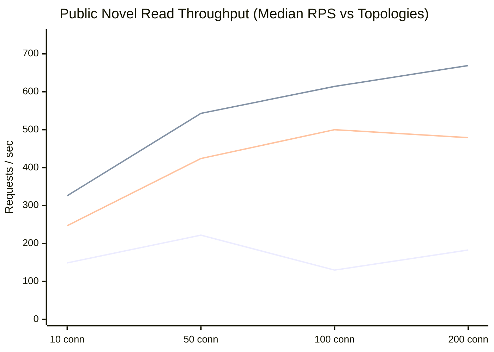

# NovelForge Microservices Architecture

NovelForge is a modern digital novel and storytelling platform built with a distributed microservices architecture powered by Spring Boot (Java 21), Spring Cloud, PostgreSQL, Redis, and React (Vite).

---

## 🏛 Architecture & Port Overview

| Service | Technology | Port (Host) | Description |
|---|---|---|---|
| **`eureka-server`** | Spring Cloud Netflix Eureka | `8761` | Central Service Discovery & Registry |
| **`api-gateway`** | Spring Cloud Gateway (WebFlux) | `8080` | Unified Edge Router & Reverse Proxy |
| **`identity-service`** | Spring Boot / JPA / Redis / JWT | `8081` | Authentication, Authorization & User Management |
| **`notification-service`** | Spring Boot / JavaMail | `8082` | Email & Notifications (OTP delivery) |
| **`novel-service`** | Spring Boot / JPA / PostgreSQL | `8083` | Novel Metadata, Chapters & Content Management |
| **`engagement-service`** | Spring Boot / JPA | `8084` | User Engagement, Likes, Bookmarks & Comments |
| **`ai-service`** | Spring Boot | `8085` | AI-assisted writing & content generation |
| **`analytics-service`** | Spring Boot | `8086` | Reading analytics & telemetry |
| **`novelforge-client`** | React 19 + Vite + Nginx | `3000` (`:80`) | Frontend Web Application |
| **`postgres`** | PostgreSQL 16 Alpine | `5432` | Relational Databases (`userDB`, `novelDB`) |
| **`redis`** | Redis 7 Alpine | `6379` | Token caching & session management |

---

## 📋 Implementation Status

| Component | Status | Description |
|---|---|---|
| **`identity-service`** | ✅ Implemented | User registration, login, JWT issuance, OTP verification, password reset, creator eligibility |
| **`novel-service`** | ✅ Implemented | Novel CRUD, chapter management in MongoDB, public catalog search, Redis caching |
| **`engagement-service`** | ✅ Implemented | Social likes, comments, library collections, follower relationships |
| **`notification-service`** | ✅ Implemented | Email delivery stubbed locally through Mailpit mock for local testing |
| **`studio-service`** | ✅ Implemented | Creator studio, workspace collaboration, chapter drafting |
| **`moderation-service`** | ⏳ Planned | Content moderation pipeline (no endpoints implemented yet) |
| **`admin-service`** | ⏳ Planned | System administration & user ban enforcement (no endpoints implemented yet) |
| **`novelforge-client`** | 🚧 In Progress | React 19 UI with TailwindCSS; core pages functional, client-service links in progress |

---

## 🐳 Docker Deployment Guide

### Prerequisites
- [Docker Engine & Docker Compose](https://www.docker.com/) installed.
- Java 21 & Node.js (if building JARs locally before containerization).

---

### Quick Start (Build & Run All Services)

#### Step 1: Build all service packages
Before spinning up the containers, package the shared security module and all microservices:

- **Windows**:
  ```cmd
  build-all.bat
  ```
- **Linux / macOS**:
  ```bash
  chmod +x build-all.sh
  ./build-all.sh
  ```

#### Step 2: Launch with Docker Compose
Start all databases, cache, service discovery, microservices, gateway, and frontend:

```bash
docker compose up -d --build
```

#### Step 3: Monitor Logs
```bash
# View logs from all services
docker compose logs -f

# View logs for a specific service
docker compose logs -f api-gateway
docker compose logs -f identity-service
```

#### Step 4: Stop Services
```bash
docker compose down
```

---

## 🚀 Individual Service Docker Build

Each service contains its own optimized Dockerfile and `.dockerignore`. To build and run any individual service:

```bash
# 1. Package the service
cd <service-name>
./mvnw clean package -DskipTests

# 2. Build the Docker image
docker build -t novelforge/<service-name>:latest .

# 3. Run the container
docker run -p <PORT>:<PORT> novelforge/<service-name>:latest
```

For `novelforge-client` (Frontend):
```bash
cd novelforge-client
docker build -t novelforge/novelforge-client:latest .
docker run -p 3000:80 novelforge/novelforge-client:latest
```

---

## ☁️ Render Cloud Deployment

NovelForge includes a turnkey [Render Blueprint](file:///C:/Users/vivek/Desktop/novelforge-server/render.yaml) (`render.yaml`) for 1-click cloud deployment on [Render](https://render.com).

- **Blueprint File**: [`render.yaml`](file:///C:/Users/vivek/Desktop/novelforge-server/render.yaml)
- **Comprehensive Guide**: [`RENDER_DEPLOYMENT.md`](file:///C:/Users/vivek/Desktop/novelforge-server/RENDER_DEPLOYMENT.md)

### Highlights:
- **Free-Tier Optimized**: Configured with `-Xmx350m -Xms200m` JVM memory limits to run smoothly within 512MB RAM free-tier instances.
- **Dynamic Port & URL Binding**: Automatically maps Render's dynamic `$PORT` and transforms Render PostgreSQL URLs to Spring JDBC format.
- **Fully Automated**: Provisions managed PostgreSQL, Redis (Key Value), Eureka Server, API Gateway, all microservices, and Nginx frontend in a single step.

---

## 📡 API Routes via Gateway (`http://localhost:8080`)

| Route Pattern | Target Service |
|---|---|
| `/api/v1/identity/**` | `identity-service` |
| `/api/v1/novels/**` | `novel-service` |
| `/api/v1/notifications/**` | `notification-service` |
| `/` | `eureka-server` dashboard at `http://localhost:8761` |
| `http://localhost:3000` | Frontend Client (React) |

---

## ⚡ Performance & Scalability (1x vs 2x vs 3x Benchmark)

NovelForge microservices were rigorously benchmarked under Docker Desktop across 1, 2, and 3 container instances per service (1.0 vCPU / 768 MB limit per container) using Autocannon with strict statistical controls (60s warm-up, 1 discarded run, 5 repetitions per cell, validated with a Little's Law cross-check):

- **Relational Write Path (Verified Persistent Social Likes)**: Tested with dynamically unique `(user, targetId)` pairs per request, verifying 100% database persistence (1 HTTP 2xx == 1 SQL `INSERT` in `engagement_likes`). Throughput scaled from **57.0 writes/s** at 10 conns ($p50 = 192\text{ ms}$) to **95.4 writes/s** at 50 conns ($p50 = 494\text{ ms}$), **101.8 writes/s** at 100 conns ($p50 = 808\text{ ms}$), and **122.0 writes/s** at 200 conns ($p50 = 1,487\text{ ms}$) with zero socket errors or timeouts.
- **Public Novel Read Scaling**: Throughput increased from **222.3 req/s** (1 instance) to **543.3 req/s** (2 instances, **2.44× speedup**) and **423.7 req/s** (3 instances, **1.91× speedup**) at 50 connections with sub-70ms $p50$. Peak throughput reached **669.0 req/s** at 200 connections.
- **Chapter Content Read (MongoDB)**: Peaked at **1,121.7 req/s** at 200 connections across 3 instances with **8–17ms $p50$**.
- **Stateless Authorization Overhead**: `GET /api/v1/identity/auth/me` verifies HMAC-SHA256 signatures statelessly with **< 1.5ms overhead** over unauthenticated reads, peaking at **1,904.7 req/s**.
- **CPU-Bound BCrypt Authentication**: `POST /api/v1/identity/auth/login` (10-round key derivation) steady-state throughput on 1x container (1.0 vCPU) is **5.7 req/s** ($p50 = 1,689\text{ ms}$, mean $= 1,603\text{ ms}$) under Linux CFS quota throttling (`cpu.stat throttled_usec: 2870s`). Adding horizontal instances scaled throughput to **14.7 req/s** across 3 instances (**2.58× horizontal speedup**, 86% efficiency across 3 cores; $p50$ dropped to 582ms).
- **Validation with Little's Law Cross-Check**: Every stable concurrency cell verified against Little's Law ($X \approx N / R$) within **< 3.5% variance**, confirming measurement validity without unmetered socket queuing.
- **Resilience Engineering (MTTR -83.8%)**: Abrupt container termination under default Spring Cloud cache settings caused a 34.0s MTTR with 31.48% dropped connections. Tuning registry fetch to 5s and cache TTL to 5s collapsed MTTR down to **5.5 seconds** with **1.20% error rate** (and 0.00% client errors via gateway idempotent retry).
- **Actuator Load Distribution Proof**: Per-instance request counting confirmed exact round-robin distribution: **50.0% / 50.0%** across 2 instances and **33.3% / 33.3% / 33.3%** across 3 instances.



👉 **Full Performance Report & Methodology**: [docs/performance/PERFORMANCE_REPORT.md](docs/performance/PERFORMANCE_REPORT.md)  
👉 **Read vs Write Capacity Breakdown**: [docs/performance/CAPACITY_PROFILE.md](docs/performance/CAPACITY_PROFILE.md)  
👉 **Architecture & Benchmark Context for Claude**: [docs/CLAUDE_CONTEXT.md](docs/CLAUDE_CONTEXT.md)
