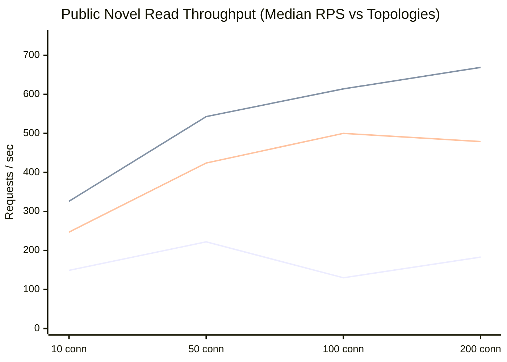

# NovelForge Microservices Architecture

NovelForge is a modern digital novel and storytelling platform built with a distributed microservices architecture powered by Spring Boot (Java 21), Spring Cloud, PostgreSQL, Redis, and React (Vite).

---

## Architecture & Port Overview

| Component | Technology | Port | Description |
|---|---|---|---|
| `novelforge-client` | React 19 JSX + Vite + Nginx | Host `3000`, container `80` | Reader, creator studio and Inbox UI |
| `api-gateway` | Spring Cloud Gateway / WebFlux | Host `8080` | Public API edge and route rewriting |
| `eureka-server` | Spring Cloud Netflix Eureka | Host `8761` | Service registry |
| `identity-service` | Spring Boot / JPA / Redis / JWT | Container `8081` | Auth, accounts, profiles, admin and moderation APIs |
| `notification-service` | Spring Boot / RabbitMQ / email adapter | Container `8082` | OTP email consumer; no browser notification route |
| `novel-service` | Spring Boot / JPA / MongoDB | Container `8083` | Novel metadata and chapter documents |
| `engagement-service` | Spring Boot / JPA / RabbitMQ | Container `8084` | Likes, comments, posts, follows, feeds and collections |
| `studio-service` | Spring Boot / JPA | Container `8087` | Studios, permissions, memberships and invitations |
| `postgres`, `mongodb`, `redis`, `rabbitmq`, `mailpit` | Docker infrastructure | Compose network; selected ports exposed locally | Persistence, cache, event broker and local email sink |

---

## 📋 Implementation Status

| Component | Status | Description |
|---|---|---|
| `identity-service` | Implemented | Registration, login, profiles, creator status, admin and moderation APIs |
| `novel-service` | Implemented | Novel metadata, chapter lifecycle and MongoDB chapter blocks |
| `engagement-service` | Implemented | Social interactions, feed and reading collections |
| `studio-service` | Implemented | Studio membership, invitations and authoring permissions |
| `notification-service` | Implemented, narrow scope | Asynchronous OTP email only; not a general in-app notification system |
| `novelforge-client` | Implemented, ongoing polish | React/Vite JSX client; lint and production build are configured |

Admin and moderation are Identity API areas. There are no separate Admin or Moderation services in the deployed topology.

---

## 🐳 Docker Deployment Guide

For the current system guide, start with [ARCHITECTURE.md](ARCHITECTURE.md). The [performance architecture notes](docs/performance/ARCHITECTURE.md) cover discovery and benchmark topology; [novelforge-architecture.html](novelforge-architecture.html) is a focused request-path illustration.

### Prerequisites
- [Docker Engine & Docker Compose](https://www.docker.com/) installed.
- Java 21 & Node.js (if building JARs locally before containerization).

---

### Quick Start (Build & Run All Services)

#### Step 1: Configure local secrets
Copy `.env.example` to `.env` and replace the example values with local random secrets. Do not commit `.env`.

For a first local admin account, set `NOVELFORGE_ADMIN_DEFAULT_PASSWORD` in the ignored `.env` before starting `identity-service`. The bootstrap creates username `admin` only if no admin exists and the username/email are unused; Spring hashes the password with BCrypt. Remove the bootstrap secret after the account is created. If an admin already exists, use User Management to promote an existing account to Moderator instead of inserting rows directly.

#### Step 2: Launch with Docker Compose

```bash
docker compose up -d --build
```

#### Step 3: Monitor Logs
```bash
# View logs from all services
docker compose logs -f

# View logs for a specific service
docker compose logs -f api-gateway
docker compose logs -f identity-service
```

#### Step 4: Stop Services
```bash
docker compose down
```

---

## 🚀 Individual Service Docker Build

Use Docker Compose for the complete stack. If you build an individual Java service that depends on `novelforge-common` or `novelforge-security`, keep the repository root as the build context:

```bash
docker build -f ./<service-name>/Dockerfile -t novelforge/<service-name>:local .
```

For `novelforge-client` (Frontend):
```bash
cd novelforge-client
docker build -t novelforge/novelforge-client:latest .
docker run -p 3000:80 novelforge/novelforge-client:latest
```

---

## Render Deployment

The repository includes a Render Blueprint at [render.yaml](render.yaml). It describes a deployment configuration; it is not proof of an active or production-ready deployment. Check current Render plans, limits, and pricing before applying it.

- **Deployment guide**: [RENDER_DEPLOYMENT.md](RENDER_DEPLOYMENT.md)

All Blueprint secrets are declared as secret inputs. Configure matching JWT signing keys and the service-specific internal credentials in the dashboard; rotate any values that may have appeared in earlier repository revisions.

---

## 📡 API Routes via Gateway (`http://localhost:8080`)

| Route Pattern | Target Service |
|---|---|
| `/api/v1/identity/**`, `/api/v1/admin/**`, `/api/v1/moderation/**` | `identity-service` |
| `/api/v1/novels/**` | `novel-service` |
| `/api/v1/studios/**` | `studio-service` |
| `/api/v1/engagement/**` | `engagement-service` |
| `http://localhost:8761` | Eureka dashboard |
| `http://localhost:3000` | Frontend client |

`notification-service` has no browser API route; it consumes OTP email events from RabbitMQ. Studio invitations are listed through the Studio API and client `/inbox`.

---

## ⚡ Performance & Scalability (1x vs 2x vs 3x Benchmark)

The checked-in load tests benchmark selected services locally under Docker Desktop. Default Compose runs one instance and uses direct service URLs. Horizontal tests use `docker-compose.perf.yml`, which switches gateway routes to Eureka `lb://` destinations and removes fixed container names where replicas are measured. Results cover specific workloads and 1-3 local instances with the resource limits described in the performance report; they do not establish production capacity or a universal maximum.

For measured throughput, methodology, bottlenecks, and test limits, see [docs/performance/CAPACITY_PROFILE.md](docs/performance/CAPACITY_PROFILE.md) and [docs/performance/PERFORMANCE_REPORT.md](docs/performance/PERFORMANCE_REPORT.md).

The existing benchmark results include:

- **Relational Write Path (Verified Persistent Social Likes)**: Tested with dynamically unique `(user, targetId)` pairs per request, verifying 100% database persistence (1 HTTP 2xx == 1 SQL `INSERT` in `engagement_likes`). Throughput scaled from **57.0 writes/s** at 10 conns ($p50 = 192\text{ ms}$) to **95.4 writes/s** at 50 conns ($p50 = 494\text{ ms}$), **101.8 writes/s** at 100 conns ($p50 = 808\text{ ms}$), and **122.0 writes/s** at 200 conns ($p50 = 1,487\text{ ms}$) with zero socket errors or timeouts.
- **Public Novel Read Scaling**: Throughput increased from **222.3 req/s** (1 instance) to **543.3 req/s** (2 instances, **2.44× speedup**) and **423.7 req/s** (3 instances, **1.91× speedup**) at 50 connections with sub-70ms $p50$. Peak throughput reached **669.0 req/s** at 200 connections.
- **Chapter Content Read (MongoDB)**: Peaked at **1,121.7 req/s** at 200 connections across 3 instances with **8–17ms $p50$**.
- **Stateless Authorization Overhead**: `GET /api/v1/identity/auth/me` verifies HMAC-SHA256 signatures statelessly with **< 1.5ms overhead** over unauthenticated reads, peaking at **1,904.7 req/s**.
- **CPU-Bound BCrypt Authentication**: `POST /api/v1/identity/auth/login` (10-round key derivation) steady-state throughput on 1x container (1.0 vCPU) is **5.7 req/s** ($p50 = 1,689\text{ ms}$, mean $= 1,603\text{ ms}$) under Linux CFS quota throttling (`cpu.stat throttled_usec: 2870s`). Adding horizontal instances scaled throughput to **14.7 req/s** across 3 instances (**2.58× horizontal speedup**, 86% efficiency across 3 cores; $p50$ dropped to 582ms).
- **Validation with Little's Law Cross-Check**: Every stable concurrency cell verified against Little's Law ($X \approx N / R$) within **< 3.5% variance**, confirming measurement validity without unmetered socket queuing.
- **Resilience Engineering (MTTR -83.8%)**: Abrupt container termination under default Spring Cloud cache settings caused a 34.0s MTTR with 31.48% dropped connections. Tuning registry fetch to 5s and cache TTL to 5s collapsed MTTR down to **5.5 seconds** with **1.20% error rate** (and 0.00% client errors via gateway idempotent retry).
- **Actuator Load Distribution Proof**: Per-instance request counting confirmed exact round-robin distribution: **50.0% / 50.0%** across 2 instances and **33.3% / 33.3% / 33.3%** across 3 instances.



👉 **Full Performance Report & Methodology**: [docs/performance/PERFORMANCE_REPORT.md](docs/performance/PERFORMANCE_REPORT.md)  
👉 **Read vs Write Capacity Breakdown**: [docs/performance/CAPACITY_PROFILE.md](docs/performance/CAPACITY_PROFILE.md)  
👉 **Architecture & Benchmark Context for Claude**: [docs/CLAUDE_CONTEXT.md](docs/CLAUDE_CONTEXT.md)
