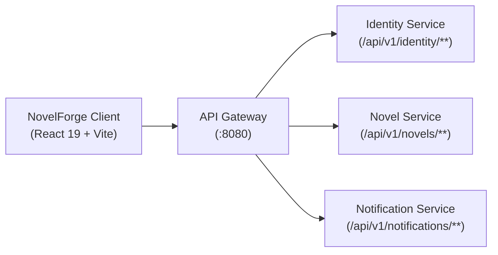

# NovelForge Web Client

A production-quality, responsive web application for NovelForge built with React 19, Vite, and React Router 7. Features complete Identity Service microservice integration with HttpOnly cookie refresh token rotation, multi-step email OTP verification, user profile lifecycle management, accessible reader typography, and a curated catalog showcase.

---

## 🌟 Architecture & Key Features

- **Microservice API Gateway Routing**:
  - All frontend API calls route exclusively through the **Spring Cloud API Gateway** via `VITE_API_BASE_URL`.
  - Zero hard-coded production domains, direct service URLs, or internal discovery endpoints leaked in client bundles.
  - Transparent error handling and automated silent 401 token refresh queue.
- **Identity & Authentication Workflows**:
  - **Login (`/login`)**: Supports identifier (username or email) and password with stateless JWT access tokens and secure HttpOnly cookie refresh tokens.
  - **Multi-Step Registration (`/register`)**: 
    1. Email submission (`POST /api/v1/identity/register/send-otp`)
    2. 6-digit OTP verification with countdown timer (`POST /api/v1/identity/register/verify-otp`)
    3. Profile creation with client-side password strength validation (`POST /api/v1/identity/register`)
  - **Forgot Password Recovery (`/forgot-password`)**:
    1. Send recovery OTP (`POST /api/v1/identity/auth/forgot-password`)
    2. Verify 6-digit OTP (`POST /api/v1/identity/auth/forgot-password/verify`)
    3. Set new password (`POST /api/v1/identity/auth/forgot-password/reset`)
  - **User Profile & Creator Privileges (`/profile`, `/me`)**:
    - Live profile syncing (`GET /api/v1/identity/profile/me` & `/auth/me`).
    - Profile metadata updates (display name, author bio, public/private visibility via `PATCH /api/v1/identity/profile/me`).
    - Real author activation/deactivation (`POST /api/v1/identity/profile/creator` and `POST /api/v1/identity/profile/creator/deactivate`).
    - Account deletion lifecycle with 30-day grace period request and cancel deletion (`DELETE /api/v1/identity/account` and `POST /api/v1/identity/account/cancel-deletion`).
- **Reading & Discovery Platform**:
  - **Novel Directory (`/novels`)**: Search across title, author, genre, and tags with real-time category filtering and list/grid layout toggle.
  - **Novel Detail Page (`/novels/:id`)**: Comprehensive synopsis, metadata, bookmarking, and chapter directory.
  - **Distraction-Free Chapter Reader (`/read/:novelId/:chapterId`)**:
    - Scroll progress bar.
    - Typography preferences: Serif, Sans-Serif, and Monospace font families.
    - Adjustable font sizing (`A-` / `A+`) and reading width toggles.
    - Dual reading themes: Minimal Light, Deep Dark, and warm Sepia paper mode.
    - Accessible keyboard navigation (Left/Right arrows for flipping chapters).
  - **Trending Leaderboard (`/trending`)**: Ranked web fiction serializations.
  - **Categories Explorer (`/categories`)**: Genre and craft guide exploration with active query filters.
- **Creator Studio & Workspace**:
  - Local author draft workspace for novel synopses and metadata.
  - Explicit transparency: Never simulates fake backend server publishing.
- **Accessibility & Ergonomics**:
  - High-contrast visible focus indicators (`:focus-visible`).
  - Screen reader semantic elements (`<header>`, `<nav>`, `<main>`, `<article>`, `<section>`, `<footer>`, ARIA labels).
  - Touch-friendly tap targets (minimum 44px on mobile devices).
  - Reduced-motion compliance (`@media (prefers-reduced-motion: reduce)`).
- **Performance & Code Splitting**:
  - Route-level lazy loading (`React.lazy` + `Suspense`) for fast first-contentful paint.

---

## ⚙️ Environment Configuration

Copy `.env.example` to `.env` or set environment variables in your deployment environment:

```bash
cp .env.example .env
```

### Environment Variables

| Variable | Description | Local Value | Production Example |
| :--- | :--- | :--- | :--- |
| `VITE_API_BASE_URL` | Base URL of the API Gateway | `http://localhost:8080` | `https://api.yourdomain.com` |
| `VITE_IMAGEKIT_URL_ENDPOINT` | Optional: Public ImageKit URL endpoint | `https://ik.imagekit.io/demo` | `https://ik.imagekit.io/your_id` |
| `VITE_IMAGEKIT_PUBLIC_KEY` | Optional: Public client key for ImageKit | `public_placeholder_key` | `public_live_key` |

> **Security Warning**: All `VITE_*` variables are public and embedded in client bundle assets. Never place JWT secrets, database credentials, or ImageKit private API keys in client environment files.

---

## 🛠️ Available Pages & Routes

| Path | Access | Description |
| :--- | :--- | :--- |
| `/` | Public | Home landing page with search, featured serials, and architecture overview |
| `/novels` | Public | Novel directory with category filters, sort options, and search |
| `/novels/:id` | Public | Dedicated novel detail page with chapter list and bookmarking |
| `/read/:novelId/:chapterId` | Public | Distraction-free chapter reader with typography controls and keyboard shortcuts |
| `/trending` | Public | Ranked leaderboard of top web fiction serials |
| `/categories` | Public | Genre and category directory with search links |
| `/community` | Public | Community discussion forum preview |
| `/login` | Guest Only | Identifier and password login |
| `/register` | Guest Only | 3-step registration wizard with email OTP verification |
| `/forgot-password` | Guest Only | Multi-step password recovery via OTP |
| `/profile` or `/me` | Protected | Account dashboard, author drafts, bookmarks, and security lifecycle |

---

## 🔌 API Gateway & Backend Dependencies

The client communicates with the backend exclusively through the API Gateway:



### Confirmed Live Backend Endpoints

- **Auth**: `POST /api/v1/identity/auth/login`, `POST /api/v1/identity/auth/refresh`, `GET /api/v1/identity/auth/me`, `POST /api/v1/identity/auth/logout`, `POST /api/v1/identity/auth/forgot-password`, `POST /api/v1/identity/auth/forgot-password/verify`, `POST /api/v1/identity/auth/forgot-password/reset`
- **Registration**: `POST /api/v1/identity/register/send-otp`, `POST /api/v1/identity/register/verify-otp`, `POST /api/v1/identity/register`
- **Profile**: `GET /api/v1/identity/profile/me`, `GET /api/v1/identity/profile/{userId}`, `PATCH /api/v1/identity/profile/me`, `POST /api/v1/identity/profile/creator`, `POST /api/v1/identity/profile/creator/deactivate`
- **Account Lifecycle**: `DELETE /api/v1/identity/account`, `POST /api/v1/identity/account/cancel-deletion`

### Known Backend Gaps & Status

1. **Novel Service Endpoints (`/api/v1/novels/**`)**:
   - The API Gateway defines routes to `novel-service`, but `NovelController.java` is currently an empty class without published endpoints.
   - *Client Handling*: Uses an isolated Curated Showcase Catalog for discovery and chapter reading. Novel publishing from the Creator Studio is clearly marked with an informative "Backend Novel Service Pending" banner rather than simulating fake server saves.
2. **Studio Service Routing (`/api/v1/studios/**`)**:
   - The `studio-service` contains internal controllers, but the API Gateway (`application.yml`) has no route configured for `studio-service`.
   - *Client Handling*: Displays a "Gateway Route Pending" notice in the Studio tab and describes the upcoming team co-authoring features.
3. **ImageKit Direct Upload Signature**:
   - No backend endpoint currently generates ImageKit client upload signatures.
   - *Client Handling*: Direct file uploads are disabled with an explicit tooltip. Initials-based avatars and preset themes are used instead.

---

## 🚀 Development & Build Commands

```bash
# Install dependencies
npm install

# Run Vite development server
npm run dev

# Run ESLint validation
npm run lint

# Build for production
npm run build

# Preview production build
npm run preview
```

### Docker & Production Deployment

The client includes a multi-stage Docker build (`Dockerfile`) and Nginx configuration (`nginx.conf`).
Deep links are handled seamlessly via Nginx's `try_files $uri $uri/ /index.html;` directive.

```bash
# Build Docker image
docker build -t novelforge-client .

# Run container
docker run -p 80:80 novelforge-client
```

---

## 📋 Testing Follow-up Notice

No unit/integration test framework was present in the client repository. In accordance with project instructions, adding a large test framework stack has been deferred and reported as an upcoming follow-up task.
